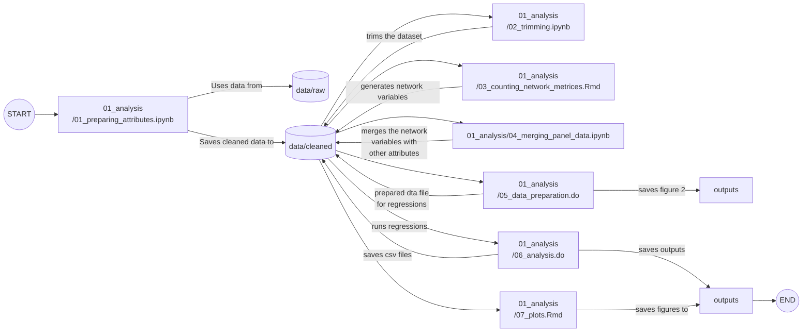

# Population_Migration_Network
This repository contains all the steps to produce the paper "Who converges with whom? Global migration network and the geography of development". It uses python to prepare the dataset and to plot the lines, R studio to visualize and Stata for panel data analysis. The folder `01_preparing` contains notebook, rmd and do file. Raw subfolder of the data folder contains all the raw data, except the annual bilateral migration data which is more than 2GB. Reproduction of the data cleaning proceess requires downloading the csv file `migration_imputed_RIKS_dec2021.csv` from the following [here](https://data.mendeley.com/datasets/cpt3nh6jct/1) and storing it in the data/raw subfolder,

### The analysis was conducted using:
-Python version 3.12.7 (packages: numpy, pandas)
-R version 4.4.3 (packages: sf, igraph, ITNr, wdnet, dplyr, plm, ggplot2, patchwork, ggraph, tidygraph,geosphere, rnaturalearth, rworldmap,)
-Stata 18.5 (packages: ivreg2, reghdfe, ivreghdfe)

### The following mermaid plot illustrates the data journey,

